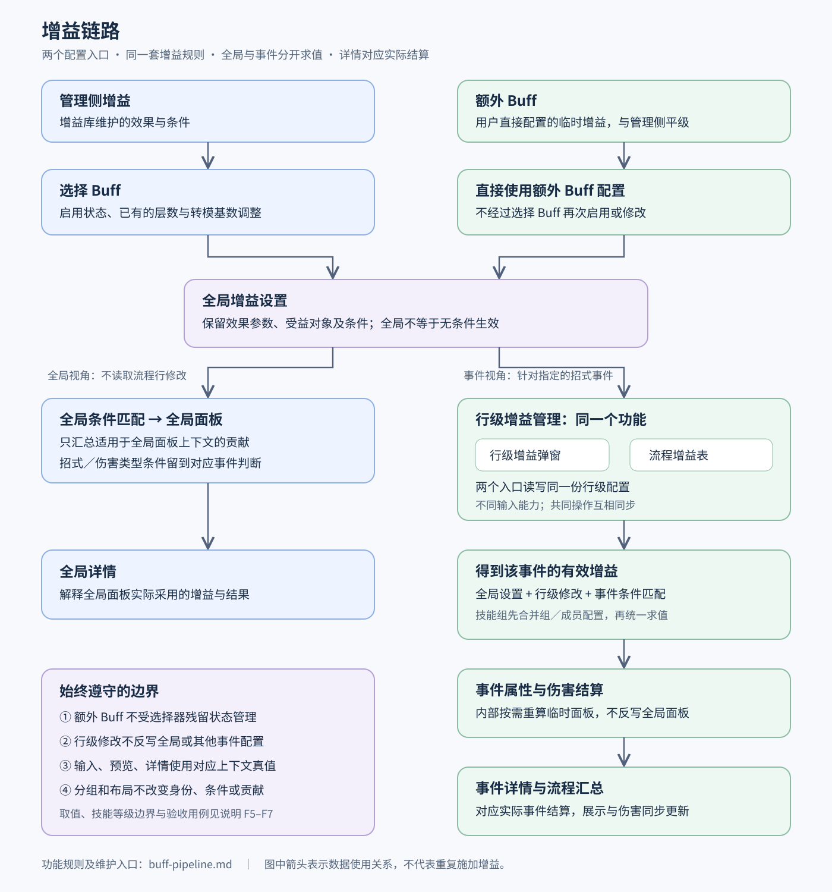

# 增益功能链路

本文定义增益从配置、全局设置到招式事件结算及详情展示的功能关系。适用于管理侧增益与额外 Buff；两者使用同一套增益规则。本文不是额外 Buff 编辑器的施工方案，也不表示全部规则已在当前代码中完成验收。

配图：[增益链路图](./buff-pipeline.svg)。图用于展示关系，行为边界以本文为准。

## F1. 两个入口，同一套增益规则

管理侧增益经过「选择 Buff」形成全局设置。选择器负责普通增益的启用状态，以及已有的层数、转模基数调整。

额外 Buff 是用户直接配置的临时增益，配置完成后直接进入全局设置，不经过「选择 Buff」再次启用或调整。它与管理侧增益平级，不具有更高的计算优先级。

两者只允许存在界面布局及以下已经确认的差异：

- 额外 Buff 使用简洁的卡片列表，不要求复制管理侧的效果块、导航和入库操作。
- 额外 Buff 的受益对象认全队或角色槽位；切换当前编辑角色不改变对象。没有固定所属角色时，转模来源槽位与受益槽位分别确定。
- 额外 Buff 沿用计算页草稿、方案的保存链路，不写入增益库。
- 额外 Buff 的全局配置由额外 Buff 模块管理，不由「选择 Buff」管理；流程中的行级管理仍然适用。

属性、条件、叠层、转模、分组及计算规则必须统一。任何其他差异必须事先取得用户明确确认，不能由实现者自行增加，也不能把当前缺陷写成额外 Buff 的专属规则。

## F2. 全局设置不是“所有事件都无条件生效”

全局设置表示未绑定到某个流程事件的增益配置，包含增益参数、启用状态和各项生效条件。带招式条件的增益仍属于全局配置，只在匹配的事件中生效。

管理侧增益的全局启用状态取自「选择 Buff」；额外 Buff 添加后直接参与正常条件判断。选择器的全选、取消、默认参数同步及历史选择记录不得修改额外 Buff 的有效配置。

全局设置有两个消费者：全局面板与招式事件结算。两者分别使用自己的上下文，不能把全局面板已经显示的增量再作为一份增益重复施加。

## F3. 全局面板和全局详情

页面上的全局面板按全局设置计算，不读取任一流程行的修改。本文所说的面板变化是计算后的局内面板变化，不是改写导入或录入的局外原始面板。

满足受益对象、职业、属性及当前全局上下文条件，并且不依赖特定招式或事件的效果进入全局面板。无招式及伤害类型限制的通用增伤，在满足其他条件时应体现在面板中。仅限定某招式或某伤害类型的效果，在相应事件中判断，不能当成通用面板增益。

全局详情解释全局面板实际采用的增益及结果。某个事件的行级修改不得反写全局面板、全局详情或全局设置。

## F4. 行级增益管理是同一个功能的两个入口

「行级增益」弹窗和「流程增益表」是同一级的管理入口，读写同一份流程行配置，没有先后应用关系。前者提供已有的参数调整和开关；后者提供跨行的开关管理。共同支持的操作必须同步，不得各维护一套生效状态。

行级配置以全局设置为基础，修改范围仅限指定的流程条目或组内成员事件。同名招式在流程中出现两次，是两个不同事件；修改其中一次不等于修改所有同名招式。

行级恢复表示取消本行的例外并重新继承，不能强制启用全局未启用的普通增益、越过受益对象或生效条件，也不能越过技能组父级禁用。流程表的开启状态表示“未被该行开关禁用”，不保证全部条件已经命中。

普通增益与额外 Buff 共用上述规则。编辑器中多效果合并显示，不改变底层效果身份，也不自动改变流程表列粒度；额外 Buff 不增加专属的合列或整卡禁用规则。

## F5. 同一事件如何得到有效参数

没有技能组时，事件参数按“本行已填写的值 → 全局已填写的值 → 效果自身默认值或来源数据”读取。没有填写表示继承，填写为 `0` 是明确的数值，不能当成未填写。

技能组成员先合并组配置和成员自己的配置，再进入同一条结算链路：禁用项取并集；层数和转模基数逐效果由成员值覆盖组值，成员未填写则继承组值。组与成员之间的继承是行级管理内部的范围关系，不是增加第三个管理入口。

额外 Buff 的全局参数取自额外 Buff 自己的配置，不读取选择器中同 id 的残留记录；该事件的有效行级覆盖仍按共享规则参与结算。

转模基数的适用规则由共享转模解析决定：

- 自行设置：使用适用的手填基数，没有手填时使用效果默认基数。
- 普通属性的局外／局内来源：有适用的手填基数时优先使用，否则读取对应来源面板。
- 技能等级来源且非自行设置：读取来源角色对应的技能等级，忽略手填基数。
- 技能等级来源且自行设置：沿用共享的手填／默认基数规则，不能扩大“非自行设置忽略覆盖”的边界。

清除成员覆盖后应显示并使用继承的组值；清除组覆盖后继续继承全局。不能在输入框、预览或结算中跳过其中一层。

## F6. 事件伤害和事件详情使用同一次求值口径

事件结算使用全局设置、合并后的行级配置以及事件自身的招式、伤害类型、受益对象等上下文，经过统一匹配与参数解析后得到实际增益贡献，再计算属性和伤害。

结算内部可以为该事件计算临时面板。这份临时面板不反写页面全局面板。修改该事件后，它的伤害、详情及受其影响的流程汇总同步更新；其他事件不因全局配置被反写而改变。

凡是展示生效状态、层数、转模基数、转模结果或增益贡献，展示值必须与所标示上下文的结算一致：

- 选择器及全局展示读取对应角色槽位的全局设置，不能混用另一个选择器视角。
- 行级输入、行级预览和事件详情使用该事件最终继承或覆盖后的值。
- 流程表列级说明可以解释全局配置；单元格中代表该事件的数值必须按该事件求值，不能直接复用列级全局数值。
- 未命中条件、被禁用的效果不能作为实际生效贡献计入详情。
- 详情可以重新调用相同结算入口以生成来源说明，但不能另写一套基数选择、条件判断或计算公式。

增益身份、来源、受益对象和效果字段应能对应到详情中的实际贡献；显示名称相同不表示同一条增益。多效果卡片和编辑分组只改变展示组织，不能导致遗漏或重复计算。

## F7. 功能核对用例

以下数值用于核对取值与范围，不定义新的伤害公式。

1. **全局通用增益**：局外攻击 `1000`，全局无事件条件的攻击 `+50` → 全局面板攻击 `1050`；未修改的事件使用这条贡献。将同等参数改为额外 Buff，结果相同。
2. **招式条件**：全局配置普攻专属增伤 `30%` → 不作为通用增伤写入全局面板；匹配普攻事件贡献 `30%`，不匹配事件贡献 `0`。
3. **同名事件隔离**：同一招式出现 A、B 两次，全局攻击增益 `+50`，只在 A 禁用 → 全局面板与 B 保持原结果，A 不再获得该增益。用弹窗或流程表操作得到相同状态。
4. **全局转模基数**：来源攻击 `2000`，比例 `10%`、初始值 `0`、无上限，全局手填基数 `3000` → 全局转模贡献 `300`；继承全局的事件、其详情和预览均为 `300`。
5. **行级转模基数**：沿用用例 4，仅 A 手填 `5000` → A 的贡献和对应展示为 `500`；全局和 B 仍为 `300`；清除 A 后恢复为 `300`。
6. **技能组继承**：沿用用例 4，组基数 `5000`、成员无覆盖 → 成员为 `500`；成员改为 `7000` → 该成员为 `700`；清除成员覆盖 → 恢复 `500`。层数使用相同的逐效果继承关系；父组禁用不能由成员恢复。
7. **显式零值**：沿用用例 4，A 手填 `0` → A 贡献为 `0`，不继承 `3000`；清除 A 的覆盖后才恢复为 `300`。
8. **槽位隔离**：自身转模在槽位 1 的全局手填为 `3000`，槽位 2 为 `7000`，比例均为 `10%` → 查看槽位 1 的流程时使用 `300`；切换选择器视角到槽位 2 不得使槽位 1 的流程展示变成 `700`。
9. **额外 Buff 入口隔离**：额外转模自行设置基数 `1000`、比例 `10%`，选择器残留基数 `2000` → 全局贡献仍为 `100`；A 行覆盖 `3000` → A 为 `300`、B 为 `100`。选择器全选或取消不改变这些结果。
10. **技能等级边界**：来源普攻等级 `12`、非自行设置、比例 `10%`，即使有手填基数 `3000` → 贡献仍为 `1.2`。自行设置时按共享手填规则处理，不套用该忽略分支。

## F8. 维护边界和代码入口

本文维护功能链路及上下文边界；配图只概括本文。额外 Buff 的编辑数据结构、迁移、序列化及实施步骤由其专项 Spec、Plan 维护，不能从图中推导额外接口。公式与各乘区行为见 [计算器公式核查表](../../CALCULATOR_FORMULAS.md)。

核对实现时从以下入口追踪，不以界面文案代替结算证据：

- [DamageCalcPage.vue](../../zzz-hp/src/components/calculator/DamageCalcPage.vue)：全局状态、选择器入口和流程文本输入。
- [SkillFlowSection.vue](../../zzz-hp/src/components/calculator/SkillFlowSection.vue)：两个行级入口及其配置写回。
- [flowBuffTable.ts](../../zzz-hp/src/utils/flowBuffTable.ts)：流程开关、`mergeFlowBuffOverride`、`effectiveRowOverride` 和展示文本。
- [panelBuffCalc.ts](../../zzz-hp/src/utils/panelBuffCalc.ts)：效果收集、`rowBuffSelectionOverlay`、贡献来源和面板计算。
- [buffEffect.ts](../../zzz-hp/src/utils/buffEffect.ts)：统一条件匹配及 `resolveConvertValue`。
- [skillFlowCalculation.ts](../../zzz-hp/src/utils/skillFlowCalculation.ts)：事件数值与详情的共同求值入口。

改动任一入口时，用 F7 同时核对全局、事件、详情及两种增益来源；不能只验证编辑器显示正常。
